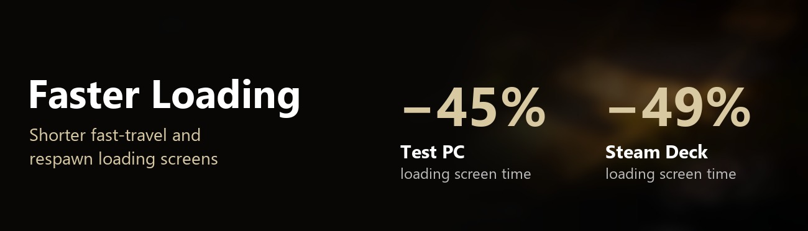
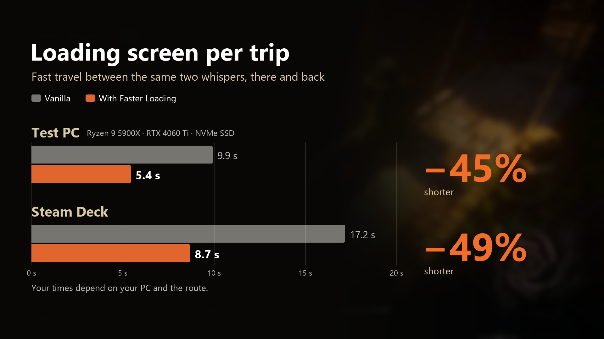

# Faster Loading



A [MelonLoader](https://github.com/LavaGang/MelonLoader) mod for **No Rest for the Wicked** that shortens the loading
screens of fast travel, respawns and dungeons: about **25-30% shorter** on the trips we measured, on a PC and on
Steam Deck.

Download: [Nexus Mods](https://www.nexusmods.com/norestforthewicked/mods/117) · [GitHub releases](https://github.com/vergir/NRftW-FasterLoading/releases/latest)

## What it changes

While such a loading screen is up, the game is held back by a few limits it keeps for smooth
gameplay. Nobody sees the world behind a loading screen, so the mod lifts them for that time and puts them back as
soon as the screen ends:

* **Parallel loading.** The game loads (and unloads) the parts of the world one after another. The mod lets it work on
  several at once.
* **Faster clean-up of the area you left.** The game unloads it in tiny slices of under 1 ms per frame, to avoid
  stutter in gameplay. During the loading screen the mod gives it 12 ms per frame.
* **No extra second at the end.** Once everything is loaded, the game waits a full second of "nothing more to load"
  before it ends the screen. The mod waits 0.25 s.

The game's memory clean-up at the end of a loading screen (about 1 s, at most every 20 s) is left alone on purpose: it
keeps that pause out of your gameplay.

Measured with the same pair of whispers back and forth, Mountain Gate and Marketplace (seconds of loading screen,
averages):



| | Vanilla | With Faster Loading |
|---|---|---|
| Test PC, one way | 11.2 | 8.4 |
| Test PC, back | 8.3 | 5.9 |
| Steam Deck, one way | 19.4 | 14.1 |
| Steam Deck, back | 12.7 | 8.8 |

Test PC: Ryzen 9 5900X, RTX 4060 Ti, NVMe SSD. Your times depend on your PC and on how much of the world has to be
loaded: long trips gain the most.

## Settings

None needed: install it and loading screens get shorter; remove it to get the game's loading back. For tinkering,
each part can be tuned or switched off in `<game>/UserData/MelonPreferences.cfg`, section `[FasterLoading]`:

| Setting | Default | |
|---|---|---|
| `ParallelLoading` | `true` | Load and unload several parts of the world at once. |
| `WorkBudgetMs` | `12` | Milliseconds per frame for the game's own loading work (game: 1, unloading 0.8). `0` = leave the game's values. |
| `IdleWaitSeconds` | `0.25` | How long loading must be idle before the screen ends (game: 1). |
| `LogLoadTimes` | `true` | Write the length of every loading screen to the MelonLoader log. |

Each loading screen is logged in `<game>/MelonLoader/Latest.log`, for example `[Faster_Loading] Loading screen: 5.8 s`.

## Install

1. Install [MelonLoader](https://github.com/LavaGang/MelonLoader/releases) **0.7.3** or newer into the game
   (`...\steamapps\common\NoRestForTheWicked`) and start the game once.
2. Put `FasterLoading.dll` into the game's `Mods` folder (the [release zip](https://github.com/vergir/NRftW-FasterLoading/releases/latest)
   already has that layout: extract it into the game folder).

### Steam Deck / Linux (Proton)

1. Install MelonLoader into the game folder the same way (copy the files from `MelonLoader.x64.zip`, the Windows build,
   into `~/.local/share/Steam/steamapps/common/NoRestForTheWicked`), and the mod into `Mods`.
2. In Steam, open the game's **Properties > General > Launch Options** and enter:
   ```
   WINEDLLOVERRIDES="version=n,b" %command%
   ```
3. Start the game. On the first start MelonLoader installs the .NET runtime it needs by itself; that start takes a
   minute or two.

## Compatibility

* Tested with game build 29466 and MelonLoader 0.7.3 on Windows and Steam Deck, solo and in a 3-hour co-op session.
* Works in co-op, and nobody else needs the mod: only your own game's loading changes. The game simulation, your save
  and other players are not touched, and outside loading screens the game runs with its own values.
* The first load into a realm (from the main menu) is not changed.
* Game updates can move things around. If the mod stops working after an update, check the MelonLoader log
  (`<game>/MelonLoader/Latest.log`, lines starting with `[Faster_Loading]`) and open an issue.

## Build

Requires a .NET SDK (6 or newer) and MelonLoader installed in the game (so `MelonLoader/Il2CppAssemblies` exists).

```
dotnet build -c Release
```

The DLL is copied to `<game>/Mods` after every build (`-p:DeployToGame=false` to skip, `-p:GameDir=...` if the game is
installed elsewhere). `pwsh ./package.ps1` builds the release zip into `dist/`. How it works inside the game:
[docs/internal.md](docs/internal.md).

## License

[MIT](LICENSE)
